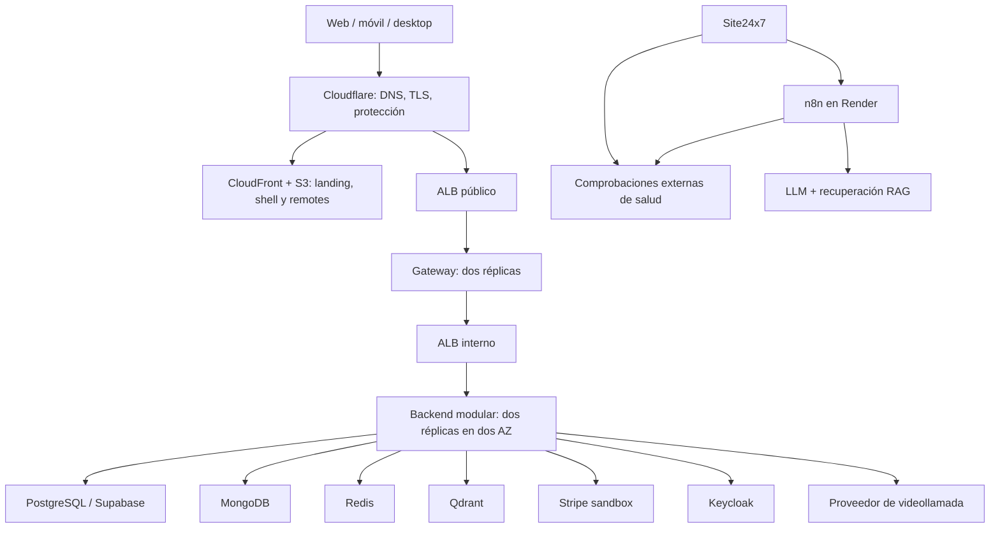

# Mentor · Documento general del sistema

**Versión:** 2.1 · **Fecha:** 25 de noviembre de 2026 · **Finalidad:** especificación inicial para construir y coordinar frontend, backend e infraestructura.

Este documento transforma el resumen de backend en una guía general del sistema, usando la información de Confluence y el checklist académico. Describe el sistema objetivo y sus criterios de aceptación. No es una auditoría de funcionalidades que ya deban estar implementadas ni acredita despliegues o pruebas realizadas.

El archivo original `09_Resumen_para_Backend.md` se conserva sin cambios. Esta revisión sustituye las decisiones anteriores incompatibles con ella: dos repositorios como organización objetivo, STOMP como tiempo real y un simulador de pagos propio. Los documentos de Confluence, Jira y los repositorios no se modifican con esta entrega.

**Cómo leer las decisiones:** “confirmado” identifica decisiones expresas de backend; “propuesta” identifica el diseño añadido para cubrir el checklist. Los valores propuestos permiten planificar, pero deberán validarse antes de implementar el componente afectado. La matriz de la sección 18 indica qué evidencia deberá producirse posteriormente; incluir una tecnología en este documento todavía no demuestra su implementación.

**Cambios de la versión 2.1** (revisión contra el checklist original `requeriments_v1.xlsx`, que ya está completo y sustituye a la foto cortada usada en la v2.0):
- Se cierran las dudas de las filas 2, 8, 11 y 14 con el texto completo del Excel.
- Se añade la sección 18.1: reglas por entorno (QA y PROD) y una tabla de seguimiento con estado y evidencia por requisito. El checklist exige cada punto en **ambos** entornos.
- SDD y ODD pasan de "aclarar" a una lectura de trabajo con entregables concretos (sección 16), pendiente de confirmar con el profesor.
- Se añade un perfil de alta disponibilidad reducido si el presupuesto no alcanza (sección 6) y se aclara el punto opcional sobre Next.js.

## 1. Producto, usuarios y alcance

Mentor permite que estudiantes de la Universidad Central del Ecuador encuentren y ofrezcan tutorías académicas. Una misma cuenta puede aprender y enseñar. El sistema ofrece catálogo de materias y servicios, disponibilidad, solicitudes y confirmación de reservas, tutorías gratuitas o pagadas, chat, acceso a una sala virtual, finalización mediante código, reseñas, reportes y administración.

La demostración académica usará datos controlados y pagos de prueba de Stripe. No contempla cobros ni retiros bancarios reales. La videollamada se integra mediante un proveedor externo con acceso privado; no se construye una plataforma propia de videoconferencia.

| Actor | Responsabilidad y permisos |
| --- | --- |
| Visitante | Ver landing e información pública y comenzar registro/inicio de sesión. |
| `STUDENT` | Buscar, reservar, pagar en sandbox, conversar con su tutor, recibir tutoría, consultar su código de finalización, reseñar y reportar. |
| `TUTOR` | Publicar servicios, gestionar disponibilidad, aceptar/rechazar solicitudes, conversar con su estudiante y finalizar la tutoría con el código recibido. Conserva también `STUDENT`. |
| `ADMIN` | Moderar servicios/reportes, gestionar parámetros, revisar operaciones e incidentes y consultar diagnósticos. No recibe automáticamente acceso irrestricto a datos privados. |
| Servicios técnicos | Ejecutar webhooks, trabajos, monitorización e indexación con credenciales y permisos propios, sin suplantar usuarios. |

El backend decide permisos, precios, disponibilidad, estados y cálculos. Frontend presenta esas decisiones y ofrece los formularios correspondientes; no replica reglas financieras como autoridad.

## 2. Decisiones y stack

| Componente | Diseño objetivo | Origen |
| --- | --- | --- |
| Backend de negocio | Java 21, Spring Boot, monolito modular con DDD y arquitectura hexagonal | Confirmado |
| Identidad | Keycloak obligatorio; OAuth 2.0/OIDC, Authorization Code + PKCE | Confirmado |
| Tiempo real | Socket.IO, incluyendo compatibilidad real entre servidor Java y cliente | Confirmado |
| Pagos | Stripe Checkout + Connect en sandbox, con webhooks y cuentas de prueba | Stripe confirmado; modalidad técnica propuesta |
| Web | React, Vite, TypeScript; shell y microfrontends; Tailwind, TanStack Query, Zustand, React Hook Form | Base documental; división en microfrontends propuesta |
| Landing | Astro; contenido público principalmente estático | Base documental |
| Móvil / escritorio | React Native / Electron, con clientes OIDC propios | Móvil de la base documental; Electron y alcance inicial propuestos |
| Datos | PostgreSQL en Supabase, MongoDB, Redis y Qdrant | Primeros tres de la base; Qdrant propuesto |
| Nube | AWS para frontend y perfil de alta disponibilidad; Render como PaaS para n8n; Supabase para PostgreSQL gestionado | Reorganización propuesta a partir de la base |
| Automatización operativa | n8n para detectar caídas y emitir alertas | Confirmado |
| IA | LLM para diagnóstico de salud; RAG sobre documentación operativa con embeddings en Qdrant | Diagnóstico confirmado; RAG propuesto |
| Observabilidad | Sentry, Site24x7 y métricas/logs en CloudWatch | Propuesta para concretar el checklist |
| WebAssembly | Módulo pequeño de cálculo de métricas para el panel de operaciones | Propuesta |

**¿Supabase es PaaS?** Se describe con más precisión como una plataforma de backend gestionado o BaaS que incluye PostgreSQL. El propio checklist lo enumera como ejemplo aceptado en ese punto. Por eso se incluye como tal, y se mantiene Render como PaaS explícito, además de AWS. Supabase no reemplaza Keycloak ni permite saltarse las reglas del backend. [Supabase Platform](https://supabase.com/docs/guides/platform), [distinción BaaS](https://www.cloudflare.com/learning/serverless/glossary/backend-as-a-service-baas/).

Las versiones concretas de librerías se fijarán en archivos de dependencias y un ADR de compatibilidad. Se debe conservar y adaptar el trabajo de las tareas existentes; este diseño no autoriza reiniciar el repositorio ni descartar sus cambios.

## 3. Monorepo y organización

Se propone un repositorio Git del producto que reúna aplicaciones, contratos, infraestructura y documentación. Cada aplicación conserva su compilación y despliegue; monorepo no significa una sola aplicación ni obliga a convertir el backend en microservicios.

```text
mentor/
  apps/
    backend/             # monolito modular Spring Boot
    gateway/             # Spring Cloud Gateway, infraestructura de entrada
    web-shell/           # navegación, sesión y carga de microfrontends
    mfe-tutoring/         # catálogo, reservas, chat y sala
    mfe-admin/            # administración y operaciones
    landing/             # Astro
    mobile/              # React Native
    desktop/             # Electron
  packages/
    design-system/
    api-client/
    contracts/           # OpenAPI, eventos, GraphQL y WSDL si se confirma SOAP
    wasm-health/         # fuente Rust y artefacto WebAssembly
  infra/
    docker/
    aws/
  workflows/n8n/
  tests/                 # E2E, carga e integración transversal
  docs/                  # especificaciones, ADR, diagramas, runbooks y evidencias
```

La migración desde los repositorios separados será una tarea explícita: preservar historiales y autoría, integrar o trasladar las ramas/PR abiertos mediante un plan acordado, actualizar rutas de CI y documentar nuevos remotos. No se ejecuta esa migración con este documento. No deben quedar dos fuentes activas con contratos divergentes.

## 4. Frontend, microfrontends y plataformas

El shell React gestiona sesión, navegación y presentación común. `mfe-tutoring` y `mfe-admin` se compilan y publican como artefactos independientes, integrados mediante Module Federation compatible con Vite. Compartir una carpeta de componentes no es suficiente para demostrar microfrontends. El shell maneja errores de carga y versiones incompatibles; los remotes publican un manifiesto versionado y se prueban también integrados. [Module Federation](https://module-federation.io/guide/start/).

El sistema de diseño comparte tokens, componentes accesibles y convenciones; el cliente API se genera desde OpenAPI. TanStack Query administra datos remotos y Zustand solo estado local que lo necesite. Los roles ocultan opciones, pero cada operación vuelve a autorizarse en backend. Los microfrontends se sirven desde orígenes controlados, con políticas CSP y sin cargar código de terceros arbitrarios.

Astro se utiliza realmente para la landing y ayuda pública. Se propone SSG para esas páginas y CSR para la aplicación autenticada. SSR e ISR son opcionales y solo se incorporarán si existe una necesidad concreta; no se exige usar los cuatro modos a la vez.

El alcance mínimo móvil/escritorio propuesto incluye login seguro, búsqueda, consulta de reservas, chat y acceso a tutoría. El administrador puede usar la web. React Native y Electron tendrán compilación y demostración propias; una web adaptable por sí sola no acredita aplicaciones móvil y desktop. El escritorio no expone Node al contenido remoto, usa aislamiento de contexto e IPC restringido. El login nativo abre navegador del sistema con PKCE y redirecciones registradas; no incluye secretos de cliente en el binario. La plataforma móvil inicial propuesta es Android; iOS queda fuera del mínimo inicial hasta disponer de entorno de compilación y dispositivos.

**Uso de WebAssembly:** el panel de operaciones carga un módulo Rust compilado a `.wasm` que calcula tasa de errores y percentiles p50/p95 sobre muestras sanitizadas. El cálculo usa nearest-rank, entradas vacías devuelven ausencia de resultado y las muestras inválidas se rechazan. Se ejecuta en Web Worker, tiene alternativa JavaScript y pruebas comparativas. No procesa datos privados ni decide si una reserva o un pago es válido. La evidencia incluirá carga efectiva del archivo WASM, igualdad de resultados y medición frente a JS; no se promete que WASM sea más rápido sin medir. [Conceptos WebAssembly](https://developer.mozilla.org/en-US/docs/WebAssembly/Guides/Concepts).

## 5. Backend, DDD y principios de diseño

El negocio permanece en un monolito modular. Sus capacidades incluyen identidad/perfil, catálogos, servicios, horarios, reservas, pagos, chat, notificaciones, reseñas, reportes, administración y operaciones/diagnóstico. Estos límites deberán mapearse a los nombres de módulos que ya se estén creando; no implican renombrar el trabajo existente automáticamente.

Cada módulo organiza `domain`, `application`, `infrastructure` y `presentation`. El dominio contiene entidades, objetos de valor, reglas e interfaces; aplicación coordina casos de uso; infraestructura adapta bases de datos y proveedores; presentación contiene controladores/DTO. Los módulos se llaman mediante interfaces públicas y eventos definidos, sin acceder directamente a tablas o repositorios ajenos.

Se aplican dos enfoques identificables: **arquitectura hexagonal** para separar negocio de proveedores, y **MVC** en la capa de presentación, con controladores, modelos de entrada/salida y vistas en los clientes web. DDD guía el modelo y los límites del monolito; no se cuenta una carpeta vacía como evidencia de arquitectura.

| Principio | Aplicación concreta |
| --- | --- |
| SOLID | Casos de uso con responsabilidad acotada; puertos para Stripe, persistencia y videollamada; dependencias hacia interfaces del negocio. |
| DRY | Un solo cálculo de precio en backend; contratos publicados y cliente generado; políticas reutilizadas sin copiar reglas entre controladores. |
| KISS | Un monolito de negocio, estados explícitos y flujos observables; sin microservicios adicionales para cumplir nombres del checklist. |
| YAGNI | No construir cobros reales, una videoplataforma propia o acciones automáticas de IA antes de que exista esa necesidad. |

Cada principio se demostrará con una decisión de diseño y código revisable, no solo mediante esta tabla.

## 6. Infraestructura, API Gateway, balanceo y disponibilidad

Se propone separar dos perfiles: **local/desarrollo**, con Docker Compose y una instancia por servicio, y **demostración de alta disponibilidad**, con recursos y costos propios. El primer perfil permite desarrollar; no acredita alta disponibilidad.



Las réplicas del gateway y backend se despliegan como servicios ECS Fargate. Los ALB distribuyen tráfico solo a destinos saludables. El gateway concentra rutas `/api/v1`, `/graphql` y `/socket.io`, límites de petición, correlación y validación de entrada. El backend vuelve a validar el JWT y permisos de negocio. Para Socket.IO el ALB interno enruta el transporte al puerto correcto del mismo despliegue del monolito; ese puerto no queda expuesto directamente a Internet. [Spring Cloud Gateway](https://docs.spring.io/spring-cloud-gateway/reference/), [AWS ALB](https://docs.aws.amazon.com/elasticloadbalancing/latest/application/introduction.html).

Keycloak tendrá un emisor HTTPS estable y réplicas con su base compartida en el perfil HA. Las migraciones de esquema se ejecutan una sola vez por despliegue y deben permitir versiones adyacentes durante la actualización gradual. Workers y tareas programadas usan exclusión distribuida o reclamación transaccional para no ejecutar vencimientos o transferencias dos veces.

**Perfil HA reducido (plan B).** Si el presupuesto no permite el perfil completo, se mantienen al menos dos réplicas del backend y del gateway detrás de un ALB, con health checks y despliegue gradual, y se registra por escrito qué dependencias siguen siendo un único nodo. Esa versión demuestra balanceo y retirada de una réplica caída, pero no debe presentarse como alta disponibilidad de extremo a extremo.

No basta con duplicar el backend: también deben seleccionarse planes/topologías de alta disponibilidad de PostgreSQL, MongoDB, Redis y Qdrant, con backups y recuperación probada. El diseño de HA queda condicionado al presupuesto y soporte real de cada plan. Una instancia gratuita o un único nodo de base de datos seguirá siendo un punto único de falla y deberá registrarse como limitación de la demostración.

Objetivos iniciales propuestos para el perfil HA: disponibilidad mensual de API de 99,5 %, RPO de datos transaccionales de hasta 15 minutos y RTO de hasta 60 minutos. Son objetivos a validar con el plan contratado y simulacros, no resultados garantizados. Medir disponibilidad desde fuera, ensayar pérdida de una réplica y restaurar un backup antes de presentar evidencia. Los backups deben cubrir también MongoDB; Qdrant se puede reconstruir desde documentos fuente y Redis no guarda el único ejemplar de datos financieros.

Render hospeda n8n con almacenamiento/base persistente y sin depender del proceso de Mentor. AWS y Render tienen responsabilidades identificadas; no se duplican despliegues del backend en dos nubes sin un caso de uso. Se documentarán región, dominios, presupuesto, retención y titularidad de cuentas antes de provisionar. [Render](https://render.com/docs).

## 7. Seguridad e identidad

Keycloak es obligatorio, no una alternativa a evaluar. Realm `mentor`, cliente web público `mentor-web`, roles `STUDENT`, `TUTOR`, `ADMIN`. Backend conserva la referencia `sub` y el perfil de negocio, nunca la contraseña. Los clientes móvil y desktop tienen registros propios con PKCE.

El registro acepta únicamente el dominio exacto `uce.edu.ec` normalizado. No admite un rol arbitrario enviado por el cliente. Publicar, activar tutor y reservar requieren correo verificado. Propuesta inicial: una cuenta verificada puede activar `TUTOR` mediante un caso de uso idempotente sin aprobación administrativa; conserva `STUDENT`. Asignar `ADMIN` requiere gestión administrativa controlada. Los tokens deben renovarse al cambiar roles.

Backend valida firma, emisor, audiencia y expiración; aplica identidad, rol, propiedad/participación y estado en cada acceso. También comprueba suspensión local. El aprovisionamiento entre Keycloak y perfil local tiene reconciliación de altas parciales. CORS solo permite orígenes exactos por ambiente; Socket.IO configura su propia validación de origen. No se utiliza `*` con credenciales. Cloudflare aporta controles de borde, mientras backend mantiene autorización, límites y validaciones.

Teléfono y correo privados no aparecen en perfiles públicos. El teléfono de contraparte solo es visible para los participantes mientras la reserva está `CONFIRMED`; la información que ya haya sido vista no se puede retirar del dispositivo del usuario. El código de finalización solo se entrega al estudiante titular y se almacena protegido, nunca en logs ni notificaciones. Secretos de Stripe, Keycloak, bases de datos, LLM y n8n quedan en el gestor de secretos del ambiente; no en Git ni bundles frontend.

Se toma OWASP Top 10:2025 como referencia para controles y pruebas, con la siguiente aplicación al sistema. [OWASP Top 10:2025](https://top10.owasp.org/2025/).

| Riesgo | Control y comprobación prevista |
| --- | --- |
| A01 Acceso roto | Probar IDOR en reservas, mensajes, reportes, salas y pagos con usuarios ajenos. |
| A02 Configuración insegura | CORS/CSP explícitos, consola administrativa restringida, sin stack traces públicos y configuración separada por ambiente. |
| A03 Cadena de suministro | Dependencias fijadas, análisis de dependencias e imágenes en CI y actualización revisada. |
| A04 Criptografía | TLS, secretos protegidos, código de finalización no recuperable desde logs y backups protegidos. |
| A05 Inyección | Consultas parametrizadas, validación de DTO, salida escapada y ningún SQL/comando generado por el LLM ejecutado automáticamente. |
| A06 Diseño inseguro | Modelo de amenazas para reservas, cancelaciones, pagos, roles y acceso a salas; restricciones transaccionales. |
| A07 Autenticación | Keycloak, PKCE, verificación de correo, límites de intentos y expiración/revocación según política. |
| A08 Integridad | Webhooks firmados, eventos idempotentes, artefactos de CI trazables y documentos RAG con procedencia/versionado. |
| A09 Registro y alertas | Auditoría de cambios sensibles, trazas sin secretos, alertas y prueba de que llegan al canal configurado. |
| A10 Excepciones | Timeouts, reintentos acotados, fallos seguros, respuestas controladas y pruebas de dependencias caídas. |

Retención, exportación y eliminación de perfiles, chat, incidentes y evidencias deberán fijarse antes de usar datos reales. En QA se usarán cuentas y conversaciones sintéticas.

## 8. Persistencia y modelo de información

Se proponen **cuatro motores distintos**, cada uno con responsabilidad real:

| Motor | Datos y responsabilidad | Consistencia |
| --- | --- | --- |
| PostgreSQL en Supabase | Perfiles de negocio, catálogo, servicios, disponibilidad, reservas, pagos, reseñas, reportes, parámetros, auditoría financiera y outbox | Fuente de verdad transaccional; restricciones y bloqueos para reservas y dinero. |
| MongoDB | Conversaciones y mensajes, notificaciones persistentes e informes de diagnóstico | Índices por conversación/fecha y por identificador de evento; consumidores idempotentes. |
| Redis | Caché con TTL, presencia, rate limiting y coordinación del tiempo real | Datos reconstruibles; nunca única fuente de reservas o movimientos financieros. |
| Qdrant | Embeddings e índices semánticos de documentación operativa para RAG | Derivado de documentos versionados; recuperable mediante reindexación. |

Keycloak y n8n pueden necesitar bases internas separadas; no se cuentan como otros motores por usar otra base PostgreSQL. `pgvector` es una extensión de PostgreSQL, no un quinto motor: Qdrant será el almacén vectorial principal y evita mantener dos índices equivalentes. La fila 11 del checklist exige al menos cuatro bases de datos, una de ellas caché y otra documental: Redis es la caché, MongoDB la documental, y PostgreSQL y Qdrant completan los cuatro motores. Queda cubierta.

Supabase se consume desde el backend con conectividad protegida y usuario de base de mínimos permisos. No se incorpora Supabase Auth, y el navegador no accede directamente a tablas de negocio con una clave privilegiada. MongoDB, Redis y Qdrant tampoco se exponen al navegador. [Qdrant](https://qdrant.tech/documentation/).

Entidades principales: `UserProfile`, `Subject`, `Category`, `TutoringService`, `AvailabilitySlot`, `Booking`, `BookingHistory`, `Payment`, `PaymentOperation`, `Review`, `Report`, `Setting`, `OutboxEvent`, `Conversation`, `Message`, `Notification`, `Incident`, `DiagnosticReport`, `KnowledgeDocument` y `KnowledgeChunk`. Las referencias entre almacenes son identificadores estables, no transacciones distribuidas implícitas.

Cambios transaccionales de reserva/pago y su evento outbox se guardan juntos en PostgreSQL. Workers publican notificaciones o proyecciones con reintentos y deduplicación. Un fallo al enviar un aviso no revierte un pago confirmado ni hace perder su registro. La creación de conversación es idempotente por `bookingId`; mensajes utilizan una clave única por remitente y `clientMessageId`.

## 9. Reglas del negocio

### 9.1 Servicios, disponibilidad y precio

Un tutor publica materia, descripción, modalidad, duración y tarifa horaria. Se proponen dos valores de `modality`: `VIRTUAL` y `PRESENCIAL`; no se añade modalidad híbrida en el mínimo inicial. El servicio presencial incluye lugar de encuentro, comunicado únicamente a participantes autorizados; el virtual usa la integración de sala. La modalidad y el lugar acordado se congelan en la reserva. Puede pausar su servicio; un servicio ocultado por moderación no se vuelve visible por activación del tutor. Las modificaciones afectan nuevas reservas, no las ya cotizadas.

Todos los importes públicos son enteros en centavos de USD. El backend calcula `sessionPriceCents = HALF_UP(hourlyPriceCents × durationMinutes / 60)` usando aritmética decimal o entera, sin `float` ni `double`. Se redondea una sola vez al total final. Ejemplo: 501 centavos/hora por 30 minutos = 250,5 → **251 centavos**. El precio por hora nulo o cero representa gratuidad, se normaliza a cero y no genera un pago.

Se congelan en la reserva tarifa, duración, importe, moneda, fechas y política vigente. La política de precio máximo se configura; su valor numérico y la penalización deben acordarse antes de habilitar servicios pagados. No se inventan esos valores en frontend. Mientras falten, `paidBookingsEnabled=false`: se permiten servicios gratuitos y se impide publicar/editar servicios con precio o crear nuevas reservas pagadas. Un tope todavía no definido no se interpreta silenciosamente como cero. Deshabilitar nuevas reservas pagadas no elimina la gestión de las existentes.

Los intervalos horarios son `[startsAt, endsAt)` en UTC y no permiten solapamientos del mismo tutor ni espacios pasados, tampoco dentro de un lote enviado en la misma petición. Un espacio reservable debe pertenecer al tutor del servicio y coincidir con su duración.

### 9.2 Reserva y concurrencia

Estados: `PENDING`, `CONFIRMED`, `REJECTED`, `CANCELLED`, `COMPLETED`, `EXPIRED`, `NO_SHOW`. `REJECTED`, `CANCELLED`, `COMPLETED`, `EXPIRED` y `NO_SHOW` son finales: ajustes financieros posteriores no reabren la reserva.

1. Estudiante verificado solicita un servicio activo y un espacio compatible con su duración. No puede reservarse a sí mismo ni mantener dos solicitudes activas para el mismo espacio.
2. Propuesta: se permiten solicitudes pendientes de estudiantes distintos para un mismo espacio; todavía no lo adjudican. Cada solicitud tiene su propia conversación.
3. Tutor confirma una solicitud dentro de una transacción que bloquea el espacio. Solo una puede ganar; las otras pendientes se rechazan con motivo `SLOT_ASSIGNED_TO_ANOTHER_BOOKING`. En confirmaciones concurrentes solo debe quedar una reserva confirmada.
4. La confirmación gratuita habilita la tutoría sin pago. La pagada establece fecha límite de pago; la confirmación por sí sola no significa pagada.
5. Si vence solicitud pendiente o pago sin éxito, se marca `EXPIRED`, se conserva historial y se libera el espacio cuando corresponda. No se revive automáticamente otra solicitud rechazada.
6. Rechazo, cancelación, expiración y finalización tienen actor, motivo y fecha. Repetir la misma acción válida no duplica efectos.

Las reservas no se borran físicamente para ocultar su historial. Crear/modificar espacios y confirmar reservas deben aplicar restricciones transaccionales, no una consulta previa sin bloqueo. El espacio conserva ocupación histórica tras `COMPLETED` o `NO_SHOW`; no se recicla un horario pasado.

| Transición | Actor / condición | Efecto adicional |
| --- | --- | --- |
| Nueva → `PENDING` | Estudiante, servicio disponible y horario futuro | Congelar acuerdo; `expiresAt=min(createdAt+plazo, startsAt)`. |
| `PENDING` → `CONFIRMED` | Tutor, antes del vencimiento | Adjudicar espacio de forma exclusiva y rechazar competidoras. |
| `PENDING` → `REJECTED` | Tutor o adjudicación a otra solicitud | Registrar motivo y notificar. |
| `PENDING` → `CANCELLED` | Estudiante titular | Sin penalización. |
| `PENDING` → `EXPIRED` | Vencimiento revalidado por backend | Registrar `REQUEST_TIMEOUT`. |
| `CONFIRMED` → `EXPIRED` | Pago requerido sin éxito dentro del plazo | Registrar `PAYMENT_TIMEOUT`, cerrar intento y liberar espacio futuro. |
| `CONFIRMED` → `CANCELLED` | Participante antes del inicio | Aplicar política financiera, revocar sala/código y liberar espacio futuro. |
| `CONFIRMED` → `CANCELLED` | Admin resuelve devolución, incluso después del inicio | Motivo `ADMIN_REFUND`; devolución total y auditoría. |
| `CONFIRMED` → `NO_SHOW` | Admin acepta inasistencia después del final | Registrar responsable y aplicar compensación/devolución, sin inferir ausencia por desconexión. |
| `CONFIRMED` → `COMPLETED` | Tutor con código válido y requisitos cumplidos | Consumir código y generar operación outbox de transferencia si corresponde. |

Cancelación, confirmación, cierre, vencimientos y webhooks bloquean y revalidan las mismas entidades en orden consistente. Un proceso periódico recupera desde PostgreSQL las acciones vencidas después de reinicios; Redis no es el único temporizador. Cada acción comprueba el plazo aunque el proceso periódico aún no haya corrido.

### 9.3 Cancelación y finalización

Propuesta: cancelación por tutor implica devolución completa del importe cobrado; cancelación del estudiante fuera del plazo gratuito aplica la penalización configurada, acotada entre cero y el importe pagado. Un pago aún no confirmado no puede inventar una devolución. El resumen financiero muestra el desglose y operaciones pendientes; los conflictos o inasistencias se revisan administrativamente.

Solo el estudiante consulta el código de finalización y lo comunica al tutor tras recibir la sesión. Solo el tutor de esa reserva puede enviarlo para completar; nunca antes de la hora de inicio. El backend comprueba reserva, ventana, intentos y pago requerido. Se genera con aleatoriedad criptográfica, se valida con hash y se conserva material cifrado solo si es necesario para mostrárselo al estudiante; consumo único. La ventana es `[startsAt, endsAt+gracia)` y un bloqueo por intentos no extiende su vigencia. Después de completar permite reseña del estudiante, una por reserva y calificación entera de 1 a 5. La reseña mutua mencionada en algunas fuentes queda fuera del mínimo inicial propuesto hasta resolver esa diferencia documental.

Si termina la ventana sin código, la reserva queda `CONFIRMED` con `requiresReview=true`; no se libera dinero automáticamente. La resolución administrativa documenta responsable, finalización/inasistencia y cualquier devolución. No se cambia retroactivamente la tarifa congelada.

### 9.4 Chat, video y reportes

Una conversación privada pertenece a una reserva y sus dos participantes. Se habilita desde `PENDING` para coordinar. Al terminar o cancelar, el historial continúa consultable; propuesta: nuevas conversaciones solo permiten envío mientras la reserva está pendiente o confirmada. Administración solo accede a contexto necesario para un reporte, con auditoría.

La sala virtual requiere participación, reserva confirmada, cuenta activa, ventana temporal y pago retenido si corresponde. Una tutoría presencial no genera sala. Backend genera credenciales temporales de un proveedor externo mediante un puerto del dominio. No se entrega una URL pública permanente como único control. Seleccionar proveedor y validar prueba de integración es un punto pendiente previo a desarrollar video.

Al confirmar una reserva virtual se crea un registro local `PROVISIONING`; la creación externa se intenta después del commit con clave estable. Sus estados son `PROVISIONING`, `READY`, `FAILED`, `CLOSED`, separados del estado de reserva. Error de proveedor no deshace la ocupación. El acceso es `[startsAt-anticipación, endsAt+tolerancia)`. Si aún se aprovisiona se devuelve `503 ROOM_PROVISIONING`; fuera de ventana o estado autorizado, `409 ROOM_NOT_AVAILABLE`. Cancelar/completar solicita cierre o revocación con reintentos. Una creación externa tardía nunca devuelve acceso a una reserva ya cancelada. No se incluyen grabación ni pizarra en el alcance inicial.

Un reporte debe referenciar un usuario, servicio o reserva con relación válida al denunciante. `NO_SHOW` solo lo presenta un participante después del final programado; `NON_PAYMENT` lo presenta el tutor ante una inconsistencia comprobable, sin convertir una reserva expirada por impago en deuda. `MISCONDUCT` requiere contexto válido del usuario/servicio denunciado. Moderación registra decisión, evidencia y justificación. Una acción administrativa de devolución inicia el mismo flujo financiero idempotente; no modifica solo una etiqueta del pago. Una cuenta suspendida no puede mutar negocio, enviar chat ni acceder a sala; conserva acceso al historial propio autorizado.

## 10. Stripe: integración de prueba con ciclo financiero completo

Se elige **Stripe**, utilizando **sandbox/test mode** y Checkout hospedado. Sustituye al simulador propio del resumen anterior. Se prueban tarjetas y eventos de Stripe, sin dinero real ni un botón propio que declare un pago aprobado. [Pruebas de Stripe](https://docs.stripe.com/testing).

Como existen tutores beneficiarios, se propone Stripe Connect con cuentas conectadas de prueba y cargos separados de transferencias. Antes de implementar se validarán país de la cuenta, disponibilidad de Connect y capacidades permitidas; no se presume que una cuenta ecuatoriana habilite cualquier modalidad. No se usarán domicilios ni identidades ficticias para abrir una cuenta real. [Stripe Connect](https://docs.stripe.com/connect/separate-charges-and-transfers).

Flujo objetivo:

1. Tutor configura cuenta conectada mediante onboarding hospedado de prueba. Backend verifica su capacidad antes de admitir servicios pagados; servicios gratuitos no dependen de Connect.
2. Estudiante solicita pago de una reserva confirmada. Backend toma el importe congelado, crea intento local y Checkout Session con clave idempotente. La URL de retorno pertenece a una lista permitida.
3. Checkout captura un cargo de prueba en la plataforma. La página de retorno solo muestra el estado consultado; no confirma el pago.
4. Un webhook firmado confirma el resultado. Backend valida firma sobre cuerpo crudo, ambiente, identificadores, moneda e importe; registra `eventId` único y actualiza de forma transaccional el pago.
5. `HELD` significa **cargo de prueba cobrado y todavía no transferido al tutor**. Es un estado interno; no se presenta como un servicio legal de escrow de Stripe ni como una autorización bancaria indefinida.
6. Al completar la tutoría se programa una transferencia de prueba a la cuenta conectada. La operación se vincula al cargo mediante `source_transaction` cuando corresponda, además de su referencia de negocio; un `transfer_group` por sí solo no reserva saldo. `RELEASED` significa transferencia a su saldo de Stripe, no retiro a una cuenta bancaria.
7. Una cancelación válida programa devolución total/parcial y, si procede, una transferencia de penalización al beneficiario establecido. Si ya hubo transferencia, el flujo debe contemplar su reversión antes de cerrar la conciliación.

No se usa una autorización de tarjeta indefinida hasta la tutoría: las autorizaciones tienen vencimiento. La modalidad propuesta captura primero y separa la transferencia posterior. [Límites de retenciones](https://docs.stripe.com/payments/place-a-hold-on-a-payment-method).

Estados de pago propuestos: `PENDING`, `HELD`, `SETTLING`, `RELEASED`, `REFUND_PENDING`, `REFUNDED`, `PARTIALLY_REFUNDED`, `FAILED`, `VOIDED`. Para una reserva gratuita se devuelve `paymentRequired=false` y `payment=null`, sin inventar un pago por cero. La reserva puede estar `COMPLETED` con transferencia todavía `SETTLING`; el frontend muestra esa diferencia.

Cada cargo, transferencia, devolución o reversión tiene un registro de operación con clave idempotente, identificador del proveedor y estado propio. Solo puede haber un intento activo por reserva; si ya existe un cargo exitoso, una nueva clave del cliente no autoriza cobrar otra vez. Un rechazo permite otro intento dentro del plazo. No existe una transacción atómica entre PostgreSQL y Stripe: se utilizan outbox, reintentos limitados, reconciliación y alertas por operaciones atascadas. No repetir una transferencia ante un timeout sin consultar su resultado previo. Webhooks duplicados o fuera de orden no hacen retroceder estados ya verificados. Para el mínimo inicial se habilitan tarjetas de prueba; no se trata `checkout.session.completed` como éxito definitivo sin verificar `payment_status` y el PaymentIntent asociado. [Webhooks](https://docs.stripe.com/webhooks).

Si llega un éxito de pago después de expirar/cancelar o liberar el espacio, se registra el cobro, se inicia devolución y no se reconfirma ni se adjudica de nuevo el espacio. El resultado se informa al estudiante. La indisponibilidad de Stripe impide nuevos pagos, pero no bloquea catálogo ni reservas gratuitas.

La comisión de Mentor se propone en cero para el ejercicio. Las tarifas del proveedor son un concepto separado: el entorno de prueba no demuestra que una futura operación real sea gratuita. El informe distingue importe bruto, devolución, penalización, transferencia, comisión del proveedor cuando aplique y saldo pendiente; las identidades contables se comprueban al conciliar operaciones terminadas. Activar dinero real exigiría una revisión fuera de este alcance.

## 11. Contratos frontend–backend y comunicaciones

### 11.1 Convenciones comunes y entregables

REST usa `/api/v1`, JSON `camelCase`, UUID, fechas ISO 8601 UTC e importes enteros en centavos. Los DTO y códigos de error se publican en OpenAPI; cualquier cambio incompatible se coordina antes de liberar el cliente. La UI muestra zona horaria explícita y traduce códigos, no textos internos.

Paginación: `page=0`, `size=20`, máximo 100; página válida sin resultados devuelve lista vacía. Listas ordenadas con desempate por `id`. Historial de chat usa cursor opaco `before`. `PUT` reemplaza campos editables, `PATCH` conserva omitidos y solo permite `null` donde el contrato lo establezca. Los DTO de entrada nunca admiten como autoridad roles, precio, dueño o estados financieros elegidos por el navegador.

Errores `application/problem+json`: `type`, `title`, `status`, `detail`, `instance`, `code`, `traceId`, `fieldErrors`. Mapa: 400 validación; 401 identidad inválida; 403 permiso/verificación/suspensión; 404 inexistente; 409 conflicto; 429 límite; 503 dependencia caída. Un error no expone secretos ni códigos de finalización.

`Idempotency-Key` UUID es obligatorio en crear reserva, iniciar pago y otras operaciones financieras iniciadas por clientes. Alcance por actor+método+ruta; misma clave/cuerpo devuelve el resultado anterior, distinto cuerpo produce 409. La retención inicial propuesta es 24 horas; las restricciones de unicidad de negocio y referencias de Stripe duran más que esa caché. Las acciones de completar/cancelar se serializan y deduplican aunque se reintenten con otra clave.

Backend entregará: OpenAPI y tipos generables; configuración Keycloak por ambiente; CORS; endpoints y eventos versionados; catálogo de errores; `GET /settings/public`; datos semilla de QA y aviso de cambios de contrato. El catálogo de rutas de la sección 20 conserva la base funcional del resumen, actualizado a Stripe. Los esquemas completos y ejemplos de cada DTO deberán concretarse en `packages/contracts` antes de implementar su pantalla.

### 11.2 Tres formas de comunicación y aclaración SOAP

| Forma | Uso concreto | Evidencia |
| --- | --- | --- |
| REST/HTTPS | Mutaciones y consultas de negocio, pagos y configuración | OpenAPI, llamadas y pruebas de autorización. |
| GraphQL/HTTPS | Consulta de panel administrativo con agregación de métricas y reservas, inicialmente solo lectura | Esquema versionado y consulta real desde `mfe-admin`; límites de profundidad/costo y mismos permisos de aplicación. |
| Socket.IO | Chat, lectura de mensajes, avisos y cambios de reserva | Intercambio real entre dos usuarios, reconexión y prueba con dos réplicas. |

La fila 14 completa pide al menos tres métodos de comunicación y enumera REST, SOAP, gRPC, webhooks, WebSocket y GraphQL como ejemplos: SOAP no es obligatorio. Se cumple con REST, GraphQL y Socket.IO (sobre WebSocket), y además con los webhooks de Stripe y n8n como cuarto método. No se construye SOAP ni gRPC; si el profesor pidiera SOAP expresamente, se añadiría el adaptador de solo lectura `ConsultarEstadoServicio` con WSDL/XSD, que reutiliza el caso de uso de salud sin datos privados. REST, GraphQL y Socket.IO sí quedan definidos como los tres mecanismos principales; GraphQL no tendrá otra implementación de reglas del negocio.

### 11.3 Contrato Socket.IO

Namespace `/mentor`, path `/socket.io`, TLS y `auth: { token: accessToken }`; no se pasan tokens por URL. Se comprueba JWT, cuenta y participación al conectar y al actuar. Al expirar token se desconecta y el cliente renueva mediante Keycloak. Socket.IO requiere servidor compatible; un WebSocket/STOMP de Spring no equivale a Socket.IO.

| Dirección | Evento | Contenido mínimo |
| --- | --- | --- |
| Cliente → servidor | `chat.send` | `conversationId`, `clientMessageId`, `content` |
| Cliente → servidor | `chat.read` | `conversationId`, `upToMessageId` |
| Servidor → cliente | `chat.message` | Mensaje persistido, autor y fecha del servidor |
| Servidor → cliente | `chat.read` | Conversación, usuario y último mensaje leído |
| Servidor → cliente | `booking.statusChanged` | Reserva, estado anterior/nuevo, motivo y versión |
| Servidor → cliente | `notification.created` | Notificación propia sin secretos |

El ack de envío confirma persistencia, no solo recepción en memoria. El cliente deduplica por identificador y recupera historial por REST después de reconectar. Los eventos contienen `eventId`, `occurredAt`, `type`, `version` y `data`; eventos viejos no sobrescriben una versión más reciente.

La primera tarea técnica de tiempo real valida biblioteca Java, protocolo cliente, autenticación y comunicación entre réplicas. Se propone WebSocket como único transporte para evitar afinidad del long polling; si se habilita fallback HTTP, se configurarán sesiones persistentes en todos los balanceadores relevantes. Redis distribuye eventos entre réplicas mediante un adaptador compatible, cuya compatibilidad con el servidor Java debe demostrarse; no se presume que un adaptador Node funcione en Java. Si Redis falla, se informa degradación y el cliente conserva recuperación por REST. [Socket.IO multinodo](https://socket.io/docs/v4/using-multiple-nodes/).

## 12. Parámetros y significado de los tiempos

Todos estos valores numéricos son **propuestas iniciales configurables** para desarrollo, no reglas impuestas por el checklist. Persistir la política efectiva cuando afecte a una reserva. Backend devuelve fechas límite y permisos de acción calculados; frontend no decide vencimientos con su reloj.

| Parámetro propuesto | Para qué sirve |
| --- | --- |
| Solicitud pendiente: 6 horas | Tiempo máximo para que el tutor responda, limitado además por el inicio de la tutoría. |
| Pago tras confirmación: 2 horas | Tiempo para completar Checkout; nunca después del inicio. Cancelar/expirar Checkout al cerrar la reserva cuando sea posible. |
| Cancelación gratuita: hasta 24 horas antes | Umbral que evita penalización del estudiante; el importe de penalización aún se debe acordar. |
| Sala: abre 10 minutos antes y cierra 15 después | Ventana de credenciales de acceso, independiente del plazo de pago. |
| Finalización: desde inicio hasta 24 horas tras final | Ventana del código; pasado ese tiempo pasa a revisión, sin liberación automática. |
| Código: 5 intentos y bloqueo de 15 minutos | Reduce adivinación; aplicar por reserva y actor sin revelar el valor. |
| Sesión: 15 a 180 minutos | Límites iniciales de duración; el espacio debe coincidir con la duración del servicio. |
| Precio máximo / penalización | Valores monetarios pendientes; validar antes de habilitar pagos. |

Si la reserva se confirma poco antes del inicio, la fecha efectiva de pago es el mínimo entre inicio y confirmación+plazo. Si esa fecha ya pasó, se rechaza la confirmación. El webhook aplica además la regla de éxito tardío de la sección 10, aunque el proveedor no permita una expiración idéntica.

## 13. Monitorización y n8n para alertas de caídas

Sentry captura errores y trazas sanitizadas; CloudWatch almacena métricas/logs de los componentes AWS; Site24x7 comprueba disponibilidad desde fuera. El panel presenta latencia, 5xx, saturación, disponibilidad, retraso del outbox y operaciones de pago pendientes. No publica stack traces, versiones sensibles ni credenciales en la salud pública. [Sentry Spring Boot](https://docs.sentry.io/platforms/java/guides/spring-boot/), [Site24x7](https://www.site24x7.com/website-monitoring.html).

Separar `liveness` (proceso vivo), `readiness` (puede aceptar tráfico de negocio) y estado de dependencias. PostgreSQL es esencial para reservas; pérdida de Redis, Qdrant, LLM o Stripe se reporta por capacidad degradada sin reiniciar en bucle todo el sistema. No exigir una llamada exitosa al LLM para que el backend se considere disponible.

**Workflow propuesto en n8n:**

1. Schedule Trigger cada 60 segundos, workflow publicado y zona horaria `America/Guayaquil`.
2. HTTP Request a salud pública/API y disponibilidad del login, con timeout de 5 segundos. Usar también una transacción sintética autorizada en QA para detectar fallos funcionales, sin crear pagos reales.
3. Tras 3 fallos consecutivos, abrir incidente por ambiente+servicio. Guardar estado de forma persistente, no solo en memoria del workflow.
4. Enviar primero alerta determinista al canal configurado de administración: componente, hora, síntoma, URL de estado y número de incidente. La alerta no espera al LLM.
5. Recopilar evidencia de solo lectura, ejecutar diagnóstico y enviar una ampliación si está disponible.
6. Repetir recordatorio cada 15 minutos mientras siga abierto; deduplicar ejecuciones simultáneas. Tras 2 comprobaciones exitosas, cerrar y avisar recuperación.

Estos intervalos son configurables; la latencia de detección depende del momento de la caída y de las comprobaciones. Site24x7 supervisa también n8n y tiene un canal directo de aviso si n8n cae. No se promete detectar una caída desde un monitor que comparte el mismo fallo sin un monitor externo.

El workflow se exporta a Git sin credenciales y tiene pruebas de caída, recuperación, timeout y deduplicación. El envío real a correo/otro canal se configurará cuando se elija el destinatario; este documento no crea automatizaciones ni envía mensajes. [Schedule Trigger](https://docs.n8n.io/integrations/builtin/core-nodes/n8n-nodes-base.scheduletrigger/), [HTTP Request](https://docs.n8n.io/integrations/builtin/core-nodes/n8n-nodes-base.httprequest/).

## 14. LLM, RAG y arquitectura de embeddings

### 14.1 Función del LLM

El LLM ayuda a explicar el estado de salud del sistema a partir de evidencia: métricas, comprobaciones, clases de error, cambios de despliegue e información recuperada de la documentación. Su salida distingue **hechos observados**, **hipótesis de causa**, **confianza**, **fuentes** y **acciones sugeridas**. Un modelo no confirma una causa solo porque su explicación suene convincente.

La orquestación se ejecuta desde n8n con acceso de servicio de solo lectura a fuentes y proveedor LLM; no depende de llamar a un endpoint del backend caído para diagnosticarlo. El backend ofrece al administrador la consulta de los informes cuando está disponible. Se fija proveedor/modelo antes de integrar, con límites de uso, costo, retención y tratamiento de datos.

No se envían contraseñas, tokens, códigos, conversaciones, información de tarjetas ni logs completos. Un extractor permite únicamente métricas agregadas, identificadores de trazas no sensibles y errores sanitizados. Timeout inicial propuesto de 12 segundos; si el modelo falla, la alerta básica sigue funcionando. El LLM no ejecuta comandos, reinicios, cambios de infraestructura, devoluciones ni modificaciones de permisos.

Ejemplo de salida contractual:

```json
{
  "incidentId": "uuid",
  "environment": "qa",
  "status": "DEGRADED",
  "observedFacts": ["Tres comprobaciones fallidas de conexión a PostgreSQL"],
  "hypotheses": [{"cause": "Conectividad o disponibilidad de PostgreSQL", "confidence": "MEDIUM"}],
  "suggestedChecks": ["Comprobar estado del proveedor y conectividad desde backend"],
  "sources": [{"documentId": "runbook-postgres", "version": "1", "section": "Conectividad"}],
  "limitations": ["No se ha ejecutado una comprobación dentro de la red de backend"],
  "requiresHumanReview": true
}
```

El esquema se valida antes de persistir/presentar el informe. Las fechas, métricas y estados operativos provienen de herramientas deterministas; la prosa del modelo no los reemplaza.

### 14.2 RAG propuesto: asistente operativo con fuentes

RAG recupera fragmentos de documentación y se los entrega al LLM como contexto. Su uso principal será **diagnóstico de incidentes con citas y ayuda al administrador**, manteniendo una misma finalidad con las alertas solicitadas.

Corpus inicial: arquitectura y ADR aprobados, dependencias por servicio, manual de despliegue/rollback, runbooks de PostgreSQL, Redis, Keycloak, Stripe, errores 5xx, latencia alta y despliegue fallido; después, postmortems revisados. No se indexan chats privados ni toda Confluence indiscriminadamente. Cada fuente tiene responsable, versión, fecha y permisos.

```text
Documentos aprobados → extracción y limpieza → fragmentación → embeddings
       → colección versionada en Qdrant
Incidente + evidencia sanitizada → consulta semántica con filtros
       → fragmentos pertinentes + sus referencias → LLM → diagnóstico con citas
```

Propuesta de indexación: fragmentos de 300–600 tokens con solapamiento aproximado de 50; conservar títulos y secciones; hash para detectar cambios. Metadatos: `documentId`, `version`, `section`, `sourceUrl`, `service`, `environment`, `accessScope`, `updatedAt`, `embeddingModel` y `contentHash`. Modelo y dimensión vectorial se fijan juntos; si cambia el modelo, se crea/reindexa una colección compatible antes de sustituir la anterior.

En consulta, filtrar por entorno, servicio y permisos antes de devolver resultados; recuperar hasta cinco fragmentos útiles y calibrar umbral con ejemplos. Si no hay evidencia suficiente, el modelo lo indica y se limita a hechos observados. No fabrica citas. Si Qdrant cae, funciona la alerta básica y puede emitirse diagnóstico sin RAG, expresamente marcado. Eliminar o revocar una fuente implica retirar sus fragmentos del índice.

Los documentos recuperados son datos no confiables como instrucciones: una frase dentro de un runbook no puede cambiar permisos del agente, pedir secretos ni autorizar acciones automáticas. Se prueba inyección de instrucciones en documentos y se limita la longitud del contexto. El administrador ve enlaces a fuentes autorizadas y puede dar feedback.

Evaluación inicial propuesta: al menos 20 incidentes sintéticos con evidencia y respuestas esperadas; medir recuperación de la fuente correcta entre los primeros resultados, citas sustentadas, abstención sin evidencia y latencia/costo. Criterios mínimos: ningún secreto filtrado, ninguna acción privilegiada ejecutada y ninguna cita a una fuente inexistente. Las respuestas se revisan por una persona; no se presenta el diagnóstico como certeza ni como sustituto del monitoreo.

La búsqueda semántica de tutores puede incorporarse después en otra colección si se requiere; no es necesaria para demostrar este RAG y no se mezcla con manuales operativos.

## 15. Pruebas: desarrollo del punto 8

La estrategia cubre backend, frontend e integración. La fila 8 completa pide pruebas de carga, unitarias, funcionales, E2E, frontend y backend dentro de CI/CD con GitHub Actions. La tabla siguiente las cubre y la sección 16 indica en qué momento del pipeline corre cada una.

| Nivel | Herramienta propuesta | Casos que debe demostrar |
| --- | --- | --- |
| Unitarias backend | JUnit y dobles de puertos | Estados de reserva, permisos, código, vencimientos, precio y redondeo. |
| Unitarias/componentes frontend | Vitest y Testing Library | Formularios, roles visibles, errores, carga, estados vacíos y accesibilidad básica. |
| Integración backend | Testcontainers y entornos de prueba | Persistencia real con PostgreSQL, MongoDB, Redis y Qdrant; restricciones, outbox y consumidores. |
| Contrato | Validación OpenAPI, esquema GraphQL y eventos | DTO, errores, compatibilidad frontend/backend; WSDL/XSD si se confirma SOAP. |
| Funcionales API | Colección automatizada o tests HTTP | Flujos y permisos reales de registro, servicios, reserva, cancelación, pago y administración. |
| E2E web | Playwright | Recorrido con usuario/tutor/admin, reserva gratuita y pagada, chat, sala, finalización y reseña. |
| Móvil y desktop | Tests de componentes y smoke en compilaciones | Login, navegación, reservas y chat en Android y Electron. |
| Carga / estrés | k6 para HTTP; cliente compatible Socket.IO para chat | Latencia, errores, capacidad, conexiones concurrentes y recuperación. |
| Seguridad | Tests negativos y análisis en CI | IDOR, roles, inyección, límites, tokens vencidos, firma de webhooks y secretos/dependencias. |
| Resiliencia / recuperación | Fallos controlados en QA | Réplica caída, dependencia no disponible, backup restaurado, alerta y diagnóstico degradado. |

Casos críticos obligatorios: dos confirmaciones concurrentes adjudican un solo espacio; reintentar pago no duplica cargos/transferencias; webhook repetido o fuera de orden no duplica efectos; un cobro tardío se devuelve sin resucitar reserva; reserva gratuita no llama a Stripe; tutor ajeno no obtiene código/sala/chat; 501 centavos por 30 minutos redondean a 251; cambio de tarifa no altera una reserva previa; caída del LLM no impide alertar; recuperación de una réplica no pierde mensajes confirmados.

La integración Stripe se prueba con sandbox, firma auténtica de eventos de prueba y herramientas del proveedor. Los tests de PR pueden usar dobles deterministas del puerto; QA ejecuta la integración real con credenciales de prueba. No se usan tarjetas ni usuarios reales en CI.

Perfil inicial de carga propuesto: rampa a 50 usuarios virtuales HTTP, 10 minutos sostenidos y descenso; dataset y recursos documentados. Objetivos orientativos para lecturas simples: p95 menor a 500 ms y errores inesperados menores a 1 %, medidos en QA sin incluir al proveedor de video ni inferencia LLM en ese mismo umbral. Es una meta a ajustar con mediciones, no capacidad prometida. Chat se prueba con clientes Socket.IO reales: un generador WebSocket genérico no acredita el protocolo Socket.IO. Añadir un ensayo prolongado y registrar uso de CPU, memoria y pools antes de sacar conclusiones.

Cada evidencia indica versión/commit, ambiente, fecha, datos, comando, resultado y limitaciones. Ninguna tabla de este documento reemplaza el reporte ejecutado.

## 16. Docker, Docker Hub, CI/CD y documentación

Docker Compose levantará backend/gateway y dependencias necesarias, con perfiles para herramientas opcionales. Cada servicio propio tiene imagen reproducible, usuario sin privilegios cuando aplique, health check y configuración externa. Se publican imágenes de backend/gateway en Docker Hub con etiqueta de commit y versión; no se despliega `latest` como única referencia. Remotes y landing generan artefactos estáticos versionados para S3/CloudFront. No se incluyen secretos ni datos reales en imágenes.

Flujo objetivo de Git: `feature/MEN-XX-descripcion` → PR a `develop` → CI → despliegue QA → validación → PR/promoción a `main` → aprobación de producción si se habilita. Si el repositorio llama a integración `dev`, se documentará esa equivalencia antes de configurar pipelines; este documento no cambia nombres de ramas existentes. El commit utiliza la identidad Git del desarrollador que realiza el trabajo.

Los PR siguen el formato pedido, por ejemplo `[MEN-12] feat: add DDD module structure`, con descripción del resultado y validación. Branches protegidas, revisión requerida y checks obligatorios se configuran como políticas reales; no se eluden para una entrega automática.

| Momento | Controles y resultado objetivo |
| --- | --- |
| PR | Compilación por rutas afectadas, unitarias, contrato, lint y análisis de secretos/dependencias. Integración crítica si cambia negocio o persistencia. |
| Merge a integración | Suite de integración, creación/escaneo de imágenes, publicación en Docker Hub y despliegue QA del commit probado. |
| Tras despliegue QA | Smoke, funcionales/E2E, migración validada y comprobación de salud. Si falla, registrar fallo y detener promoción. |
| Programado/manual en QA | Carga, resiliencia, recuperación y evaluación RAG; evitar carga destructiva sobre producción. |
| Promoción | Referenciar el mismo artefacto validado; aprobación prevista por el equipo y rollback documentado. |

Se construirán pipelines para cada app, con validación integrada shell/remotes antes de promover combinaciones incompatibles. La documentación incluye README local, variables sin secretos, OpenAPI/Swagger, eventos, esquema GraphQL, C4, secuencias, modelo de datos, ADR, runbooks, changelog y evidencias por requisito.

**SDD y ODD:** el Excel solo dice "SDD, ODD" sin definirlas. Hasta que el profesor lo confirme se adopta esta lectura de trabajo, con entregables propios:
- **SDD (Spec-Driven Development):** la especificación (OpenAPI, esquema GraphQL, contrato Socket.IO, esquemas de eventos y este documento) se escribe y revisa antes del código; el cliente API se genera desde ella y CI falla si el código se aparta del contrato. Entregables: `packages/contracts` versionado, tests de contrato en CI y trazabilidad requisito → especificación → prueba.
- **ODD (Observability-Driven Development):** cada funcionalidad define junto con su código sus métricas, logs estructurados, trazas, health checks y alertas, y no se considera terminada sin ellos. Entregables: lista de señales por módulo, alertas en Sentry, Site24x7 y CloudWatch, y prueba de que la alerta llega (sección 13).

Si el profesor entiende otra cosa (por ejemplo, diseño dirigido por objetos con entidades, objetos de valor y responsabilidades), se añaden esos artefactos sin reemplazar los anteriores.

## 17. Orden de construcción y coordinación

1. Cerrar dudas del checklist, valores monetarios y cuentas/proveedores. Acordar ADR de monorepo, despliegue y compatibilidad Socket.IO antes de comprometer sus integraciones.
2. Consolidar el esqueleto backend existente, contratos, Keycloak, datos base y entorno Compose; crear shell/landing y pipelines mínimos.
3. Implementar servicios, horarios y reservas gratuitas con transacciones, chat y reglas de privacidad; validar recorridos entre frontend y backend.
4. Integrar Stripe sandbox/Connect, cancelaciones, devoluciones, conciliación y proveedor de sala. Añadir reseñas, reportes y administración.
5. Completar microfrontends desplegables, clientes Android/Electron y módulo WASM. Publicar imágenes y preparar infraestructura AWS/PaaS.
6. Implementar observabilidad y n8n; escribir runbooks, indexarlos con embeddings y añadir LLM/RAG. Alertas deterministas primero.
7. Ejecutar pruebas de integración, E2E, carga, seguridad, HA y recuperación; producir evidencias y corregir hallazgos antes de la entrega.

Backend lidera reglas, contratos, identidad, persistencia, pagos y adaptadores. Frontend lidera experiencia, shell/remotes, clientes y renderizado de estados. Infraestructura/QA se asignan explícitamente; contratos, integración, criterios de aceptación y seguridad se revisan entre ambos. Esta secuencia no crea tickets ni fija fechas de entrega ficticias.

## 18. Trazabilidad del checklist académico

“Diseñado” significa incorporado a esta especificación; “propuesto” requiere aceptación técnica del equipo; “aclarar” depende del texto completo o definición del profesor. La evidencia se producirá durante la construcción.

| # | Requisito visible | Aplicación en el diseño | Evidencia esperada / precisión pendiente |
| --- | --- | --- | --- |
| 1 | Monorepo | Propuesto, sección 3 | Repositorio con apps, contratos, infraestructura y pipelines por aplicación. |
| 2 | Lenguaje y framework | Java 21 + Spring Boot confirmados, sección 2 | Build del backend ejecutable y SPA React corriendo (fila completa: Spring Boot en backend y ReactJS en web). |
| 3 | Web, móvil, desktop, roles | Diseñado, secciones 1, 4 y 7 | Demostración web/Android/Electron y pruebas de permisos. |
| 4 | Microfrontends | Propuestos, sección 4 | Shell y dos remotes compilados/publicados separadamente e integrados. |
| 5 | Cloudflare / Keycloak / CORS | Diseñado, secciones 6 y 7 | Configuración y pruebas de orígenes, JWT y acceso al borde. |
| 6 | AWS + PaaS | Propuesto, secciones 2 y 6 | AWS, Render para n8n y Supabase PostgreSQL; recursos y responsabilidades documentados. |
| 7 | Pasarela de pagos | Stripe confirmado, sección 10 | Checkout, Connect, webhooks, transferencias y devoluciones en sandbox. |
| 8 | Testing | Añadido, sección 15 | Unitarias, frontend, backend, funcionales, E2E y carga, ejecutadas en GitHub Actions. |
| 9 | Docker / Docker Hub | Diseñado, sección 16 | Compose, imágenes publicadas y despliegue por versión. |
| 10 | Al menos 4 principios | SOLID, DRY, KISS y YAGNI, sección 5 | Ejemplos implementados y decisiones revisables. |
| 11 | Al menos 4 DB, una caché | Propuestos PG, MongoDB, Redis, Qdrant, sección 8 | Uso real de cuatro motores, con Redis como caché y MongoDB como documental. |
| 12 | API Gateway | Propuesto Spring Cloud Gateway, sección 6 | Rutas, límites y autenticación comprobados. |
| 13 | Load Balancer | Propuesto AWS ALB, sección 6 | Tráfico distribuido y destino fallido retirado. |
| 14 | Al menos 3 comunicaciones | REST, GraphQL y Socket.IO, sección 11 | Llamadas reales de REST, GraphQL y Socket.IO, más webhooks; SOAP no es obligatorio. |
| 15 | Al menos 2 arquitecturas | Hexagonal y MVC, sección 5 | Diagramas, casos de uso y adaptadores; monolito modular DDD como organización del negocio. |
| 16 | Monitoreo / alertas | Sentry, Site24x7 y n8n, sección 13 | Error/caída provocados, alerta recibida y recuperación documentada. |
| 17 | Alta disponibilidad | Perfil HA propuesto, sección 6 | Dos réplicas/AZ, dependencias HA y simulacro; limitaciones según presupuesto. |
| 18 | Documentación / commits / PR | Diseñado, sección 16 | Swagger, README, ADR, PR y commits convencionales trazables. |
| 19 | LLM o VLM | LLM diagnóstico confirmado, sección 14 | Informe sobre evidencia controlada, límites y evaluación. |
| 20 | n8n | Alertas de caídas confirmadas, sección 13 | Workflow exportado, persistencia y pruebas de alerta/recovery. |
| 21 | RAG | Asistente operativo propuesto, sección 14 | Recuperación de runbook y diagnóstico con citas autorizadas. |
| 22 | Astro | Landing, sección 4 | Build y sitio desplegado con Astro. |
| 23 | SDD / ODD | Lectura de trabajo propuesta, sección 16 | Contratos versionados con tests de contrato en CI (SDD) y señales/alertas por módulo (ODD). Confirmar la definición con el profesor. |
| 24 | WebAssembly | Cálculo de métricas propuesto, sección 4 | WASM cargado realmente, resultados comprobados y comparación JS. |
| 25 | Arquitectura de embeddings | Pipeline propuesto, sección 14 | Ingesta, modelo/dimensión, Qdrant, filtros, actualización y evaluación. |
| 26 | OWASP | Controles y pruebas diseñados, sección 7 | Evidencia de controles y resultados de pruebas negativas/análisis. |

Opcional (SSR, SSG, ISR y CSR "con un framework como Next.js"): SSG en la landing con Astro y CSR en la aplicación; SSR/ISR solo si surge una necesidad. Next.js no se adopta: Astro y la SPA cubren los modos necesarios, y se deja como decisión registrada en un ADR. No se asigna un porcentaje de cumplimiento porque esta es una especificación inicial; el estado real se registra en la sección 18.1.

## 18.1 Cumplimiento por entorno y seguimiento

El checklist marca cada requisito para **QA y PROD**. Ambos entornos usan la misma arquitectura, las mismas imágenes y el mismo pipeline; cambian secretos, datos y alcance de las pruebas.

| Aspecto | QA | PROD |
| --- | --- | --- |
| Artefactos | Imagen y bundles del commit que pasó CI | Los mismos artefactos ya validados en QA, promovidos sin reconstruir |
| Datos | Sintéticos | Controlados de demostración, sin datos personales reales |
| Pagos | Stripe en modo de prueba | Stripe en modo de prueba (sin dinero real) |
| Secretos y dominios | Gestor de secretos y orígenes CORS propios de QA | Gestor de secretos y orígenes CORS propios de PROD |
| Alta disponibilidad | Perfil reducido o completo | Perfil completo, o el reducido con la limitación registrada |
| Pruebas | Todas, incluidas carga, resiliencia, recuperación y evaluación RAG | Smoke y salud tras desplegar; sin carga destructiva |
| Monitoreo | Sentry, Site24x7 y n8n con canal de QA | Sentry, Site24x7 y n8n con su propio canal |

**Seguimiento.** Estados: ☐ Diseñado, ◐ Implementado, ☑ Verificado (con enlace al commit, reporte o captura y fecha). Todo empieza en "Diseñado"; ningún requisito se da por cumplido hasta que ambas columnas estén verificadas.

| # | Requisito | Evidencia mínima | QA | PROD | Enlace / commit / fecha |
| --- | --- | --- | --- | --- | --- |
| 1 | Monorepo | Repositorio con apps, contratos, infra y pipelines por app | ☐ Diseñado | ☐ Diseñado | |
| 2 | Spring Boot + React | Backend y SPA ejecutándose | ☐ Diseñado | ☐ Diseñado | |
| 3 | Web, móvil, desktop, roles | Demostración web, Android y Electron; pruebas de permisos | ☐ Diseñado | ☐ Diseñado | |
| 4 | Microfrontends | Shell y 2 remotes desplegados por separado e integrados | ☐ Diseñado | ☐ Diseñado | |
| 5 | Cloudflare, Keycloak, CORS | Configuración y pruebas de origen, JWT y borde | ☐ Diseñado | ☐ Diseñado | |
| 6 | AWS + PaaS | Recursos en AWS, Render y Supabase documentados | ☐ Diseñado | ☐ Diseñado | |
| 7 | Stripe | Checkout, webhook, transferencia y devolución en sandbox | ☐ Diseñado | ☐ Diseñado | |
| 8 | Testing en CI/CD | Reporte de GitHub Actions con carga, unitarias, funcionales, E2E, front y back | ☐ Diseñado | ☐ Diseñado | |
| 9 | Docker y Docker Hub | Imágenes publicadas con etiqueta de commit | ☐ Diseñado | ☐ Diseñado | |
| 10 | 4+ principios | Ejemplos de código revisados | ☐ Diseñado | ☐ Diseñado | |
| 11 | 4+ BD (caché y documental) | Cuatro motores en uso real | ☐ Diseñado | ☐ Diseñado | |
| 12 | API Gateway | Rutas, límites y JWT comprobados | ☐ Diseñado | ☐ Diseñado | |
| 13 | Load balancer | Tráfico repartido y destino caído retirado | ☐ Diseñado | ☐ Diseñado | |
| 14 | 3+ comunicaciones | Llamadas reales REST, GraphQL, Socket.IO | ☐ Diseñado | ☐ Diseñado | |
| 15 | 2+ arquitecturas | Diagramas y código hexagonal y MVC | ☐ Diseñado | ☐ Diseñado | |
| 16 | Monitoreo y alertas | Caída provocada, alerta recibida y recuperación | ☐ Diseñado | ☐ Diseñado | |
| 17 | Alta disponibilidad | Simulacro de pérdida de réplica | ☐ Diseñado | ☐ Diseñado | |
| 18 | Documentación | Swagger, README, ADR, PR y commits convencionales | ☐ Diseñado | ☐ Diseñado | |
| 19 | LLM o VLM | Informe de diagnóstico con evidencia controlada | ☐ Diseñado | ☐ Diseñado | |
| 20 | n8n | Workflow exportado y prueba de alerta y recuperación | ☐ Diseñado | ☐ Diseñado | |
| 21 | RAG | Diagnóstico con citas de runbooks | ☐ Diseñado | ☐ Diseñado | |
| 22 | Astro | Landing construida y desplegada | ☐ Diseñado | ☐ Diseñado | |
| 23 | SDD y ODD | Contratos con tests y señales por módulo | ☐ Diseñado | ☐ Diseñado | |
| 24 | WebAssembly | WASM cargado, resultados iguales a JS y medición | ☐ Diseñado | ☐ Diseñado | |
| 25 | Embeddings | Ingesta, modelo y dimensión, filtros y evaluación | ☐ Diseñado | ☐ Diseñado | |
| 26 | OWASP | Controles y resultados de pruebas negativas | ☐ Diseñado | ☐ Diseñado | |
| Opc. | SSR, SSG, ISR, CSR | SSG en landing y CSR en la SPA; ADR sobre Next.js | ☐ Diseñado | ☐ Diseñado | |

## 19. Puntos por cerrar y aceptación del diseño

Antes de implementar el componente correspondiente deben cerrarse: confirmación con el profesor de la definición de SDD/ODD; aprobación de la migración a monorepo y presupuesto del perfil HA; proveedor de videollamada; cuenta y capacidades Stripe Connect; precio máximo, penalización y beneficiario; aceptación de parámetros temporales; biblioteca Socket.IO Java y adaptador multinodo; activación de tutor sin aprobación; reseñas solo del estudiante; proveedor/modelos de LLM y embeddings; canal de alertas y retención de datos.

Los demás detalles de implementación pueden resolverse por el equipo dentro de estas reglas y registrarse en ADR. Ninguno de estos pendientes impide comenzar el núcleo gratuito y sus contratos; sí impide declarar cerrada la integración afectada.

El recorrido de aceptación final mostrará: registro UCE y roles; publicación de servicio; solicitud y confirmación exclusiva; reserva gratuita y otra con Stripe de prueba; chat privado; acceso temporal a sala; finalización y reseña; cancelación con devolución; panel administrativo; carga de microfrontends y WASM; uso básico móvil/desktop; caída controlada con alerta n8n y diagnóstico con fuente RAG; retirada de una réplica sin caída total y restauración de datos. Cada demostración se enlazará a su versión y prueba.

## 20. Catálogo funcional de rutas

Todas estas rutas llevan `/api/v1`, salvo las que indican otra base. Se conserva el catálogo funcional del resumen previo con los cambios de Stripe. Cada acceso incluye rol, propiedad/participación y estado; “participante” nunca significa cualquier cuenta autenticada. Los detalles de esquemas se versionarán en OpenAPI.

| Método y ruta | Acceso | Entrada | Salida | Errores clave |
| --- | --- | --- | --- | --- |
| `GET /settings/public` | Público | — | `PublicSettings` | — |
| `GET /catalog/subjects` | Público | — | Lista de materias | — |
| `GET /catalog/categories` | Público | — | Lista de categorías | — |
| `POST /auth/register` | Público | `RegisterRequestDto` | `201 { userId, email, verificationRequired }` | `EMAIL_NOT_UCE`, `EMAIL_ALREADY_REGISTERED` |
| `POST /auth/resend-verification` | Público | `{ email }` | `204` para correo existente o inexistente | `RATE_LIMITED` |
| `GET /users/me` | Autenticado | — | `UserProfileResponseDto` | — |
| `PUT /users/me` | Autenticado | Nombre, apellido, teléfono, bio, carrera, avatar | `UserProfileResponseDto` | `VALIDATION_ERROR` |
| `POST /users/me/tutor-role` | Autenticado verificado | — | `TutorRoleResponseDto` | `ACCOUNT_NOT_VERIFIED` |
| `GET /users/{id}/public-profile` | Autenticado | — | `PublicProfileResponseDto`, sin teléfono/correo privados | `NOT_FOUND` |
| `POST /services` | Tutor verificado | `CreateServiceRequestDto` | `201 ServiceResponseDto` | `PRICE_ABOVE_CAP`, `ACCOUNT_NOT_VERIFIED` |
| `GET /services` | Autenticado | `q, subjectId, categoryId, modality, minPriceCents, maxPriceCents, minRating, availableFrom, availableTo` + página | `Page<ServiceResponseDto>` | `VALIDATION_ERROR` |
| `GET /services/{id}` | Autenticado | — | `ServiceResponseDto` | `NOT_FOUND` |
| `GET /services/mine` | Tutor | Página | `Page<ServiceResponseDto>` | — |
| `PUT /services/{id}` | Tutor dueño | Igual que crear | `ServiceResponseDto` | `FORBIDDEN`, `PRICE_ABOVE_CAP` |
| `PATCH /services/{id}/status` | Tutor dueño | `{ status: ACTIVE \| PAUSED }` | `ServiceResponseDto` | `FORBIDDEN` |
| `GET /tutors/{tutorId}/slots` | Autenticado | `from, to, onlyAvailable=true` | Lista de espacios | `VALIDATION_ERROR` |
| `GET /schedules/slots/mine` | Tutor | `from, to` | Lista de espacios | — |
| `POST /schedules/slots` | Tutor verificado | `{ slots: [{ startsAt, endsAt }] }` | `201` lista de espacios | `SLOT_OVERLAP`, `SLOT_IN_PAST`, `INVALID_SLOT_DURATION` |
| `DELETE /schedules/slots/{id}` | Tutor dueño | — | `204` | `FORBIDDEN`, `SLOT_TAKEN`, `SLOT_HAS_REQUESTS` |
| `POST /bookings` | Estudiante verificado | `{ serviceId, slotId, note }` + clave | `201 BookingResponseDto` (`PENDING`) | `CANNOT_BOOK_OWN_SERVICE`, `SLOT_TAKEN`, `DUPLICATE_BOOKING`, `SLOT_DURATION_MISMATCH` |
| `GET /bookings/mine` | Autenticado | `role=STUDENT\|TUTOR`, `status` + página | `Page<BookingResponseDto>` | — |
| `GET /bookings/{id}` | Participante | — | `BookingResponseDto` | `FORBIDDEN`, `NOT_FOUND` |
| `GET /bookings/{id}/history` | Participante | — | Lista cronológica de cambios | `FORBIDDEN` |
| `POST /bookings/{id}/confirm` | Tutor de la reserva | — | `BookingResponseDto` (`CONFIRMED`) | `SLOT_TAKEN`, `INVALID_BOOKING_TRANSITION` |
| `POST /bookings/{id}/reject` | Tutor de la reserva | `{ reason }` | `BookingResponseDto` (`REJECTED`) | `INVALID_BOOKING_TRANSITION` |
| `POST /bookings/{id}/cancel` | Participante | `{ reason }` | `BookingResponseDto` (`CANCELLED`) | `INVALID_BOOKING_TRANSITION` |
| `POST /bookings/{id}/payment` | Estudiante de la reserva | `{ provider: STRIPE, returnUrl }` + clave | `201 StartPaymentResponseDto` | `PAYMENT_NOT_ALLOWED`, `INVALID_RETURN_URL` |
| `GET /bookings/{id}/payment` | Participante | — | `PaymentSummaryDto` o `404` si no existe | `NOT_FOUND` |
| `GET /bookings/{id}/completion-code` | Estudiante de la reserva | — | `{ code, validFrom, validUntil }` | `FORBIDDEN`, `COMPLETION_CODE_NOT_AVAILABLE` |
| `POST /bookings/{id}/complete` | Tutor de la reserva | `{ code }` | `BookingResponseDto` (`COMPLETED`) | `INVALID_COMPLETION_CODE`, `COMPLETION_CODE_EXPIRED`, `PAYMENT_NOT_HELD`, `RATE_LIMITED` |
| `GET /bookings/{id}/video-room` | Participante | — | `VideoRoomResponseDto` | `ROOM_NOT_AVAILABLE`, `ROOM_PROVISIONING`, `PAYMENT_NOT_HELD` |
| `GET /conversations` | Autenticado | Página | `Page<ConversationDto>` | — |
| `POST /conversations` | Participante | `{ bookingId }` | `201` nueva o `200` existente, `ConversationDto` | `FORBIDDEN`, `NOT_FOUND` |
| `GET /conversations/{id}/messages` | Participante | `before, size` | `MessagePageDto` | `FORBIDDEN` |
| `GET /notifications` | Autenticado | Página | `Page<NotificationDto>` | — |
| `PATCH /notifications/{id}/read` | Dueño de notificación | — | `204` | `FORBIDDEN` |
| `POST /notifications/read-all` | Autenticado | — | `204`, solo avisos propios | — |
| `POST /bookings/{id}/reviews` | Estudiante de reserva completada | `{ rating, comment }` | `201 ReviewDto` | `REVIEW_NOT_ALLOWED`, `REVIEW_ALREADY_EXISTS` |
| `GET /users/{id}/reviews` | Autenticado | Página | `Page<ReviewDto>` | — |
| `POST /reports` | Autenticado | `{ type, bookingId, targetUserId, targetServiceId, description }` | `201 { id, status, createdAt }` | `VALIDATION_ERROR`, `REPORT_NOT_ALLOWED` |
| `GET /admin/services` | Admin | `status, moderationStatus` + página | `Page<ServiceResponseDto>` | — |
| `PATCH /admin/services/{id}/moderation` | Admin | `{ action: APPROVE \| HIDE, reason }` | `ServiceResponseDto` | — |
| `GET /admin/reports` | Admin | `status` + página | `Page<ReportDto>` | — |
| `GET /admin/reports/{id}` | Admin | — | Reporte y contexto autorizado de reserva/chat | `NOT_FOUND` |
| `PATCH /admin/reports/{id}` | Admin | `{ resolution: DISMISSED \| WARNING \| SUSPEND_USER \| REFUND \| MARK_NO_SHOW, responsibleParty: STUDENT \| TUTOR \| null, note }` | `ReportDto` | `INVALID_REPORT_RESOLUTION` |
| `GET /admin/settings` | Admin | — | Parámetros | — |
| `PUT /admin/settings` | Admin | Parámetros editables | Parámetros | `VALIDATION_ERROR` |
| `GET /admin/metrics` | Admin | — | Métricas de uso y pagos Stripe de prueba identificados | — |

Rutas añadidas para esta revisión:

| Método y ruta | Acceso | Resultado / regla |
| --- | --- | --- |
| `POST /tutors/me/payment-account/onboarding` | Tutor verificado | URL de onboarding Stripe Connect sandbox, creada por backend; retorno permitido. |
| `GET /tutors/me/payment-account` | Tutor titular | Estado de cuenta y capacidades; no secretos. |
| `POST /webhooks/stripe` fuera de `/api/v1` | Firma Stripe | Cuerpo crudo, evento único y procesamiento idempotente; no JWT de estudiante. |
| `POST /graphql` fuera de `/api/v1` | Admin | Consultas de panel autorizadas con límites de complejidad. |
| `GET /health/live`, `GET /health/ready` fuera de `/api/v1` | Público mínimo / infraestructura | Respuesta mínima; detalle interno restringido. |
| `GET /admin/health` | Admin | Salud por componente, evidencia y fecha de medición. |
| `GET /admin/incidents` y `GET /admin/incidents/{id}` | Admin | Incidentes, métricas sanitizadas y diagnósticos autorizados. |
| `GET /admin/diagnostics/{id}` | Admin | Informe del LLM, límites y citas; sin acceso automático a fuentes privadas. |

`StartPaymentResponseDto`: `paymentId`, `provider: STRIPE`, `testMode: true`, `checkoutUrl`, `expiresAt`. `PaymentSummaryDto`: estado, moneda, importe bruto, importes acumulados de devolución/transferencia/penalización, operaciones pendientes y `version`. No se devuelve `provider: SIMULATED` ni endpoints de aprobación manual del simulador anterior.

`BookingResponseDto` incluye precios/fechas congelados, `paymentRequired`, fechas límite, `requiresReview`, `version` y acciones permitidas; no contiene el código. `PublicProfileResponseDto` excluye teléfono/correo privados. `VideoRoomResponseDto` contiene proveedor y acceso temporal, nunca secretos permanentes. Las respuestas de administración también filtran datos según el caso de uso.

## 21. Base documental y referencias

Base: `09_Resumen_para_Backend.md`, revisión previa de coordinación y el checklist `requeriments_v1.xlsx` del profesor (texto completo, en lugar de la foto cortada de la v2.0).

Confluence consultado como fuente de lectura: [Technology Stack](https://kevinteno11.atlassian.net/wiki/spaces/MEN/pages/655468), [Client Applications](https://kevinteno11.atlassian.net/wiki/spaces/MEN/pages/655524), [ADR](https://kevinteno11.atlassian.net/wiki/spaces/MEN/pages/131114), [Architecture Overview](https://kevinteno11.atlassian.net/wiki/spaces/MEN/pages/786547), [Security](https://kevinteno11.atlassian.net/wiki/spaces/MEN/pages/786575), [Deployment](https://kevinteno11.atlassian.net/wiki/spaces/MEN/pages/655486). Las decisiones más recientes de backend indicadas en este documento prevalecen sobre alternativas anteriores; las páginas no se editaron.

Las referencias técnicas oficiales están junto a la decisión que sustentan. Los tamaños de infraestructura, valores operativos, organización en microfrontends, módulo WASM y diseño RAG son propuestas de esta revisión, no hechos atribuidos a las fuentes.
